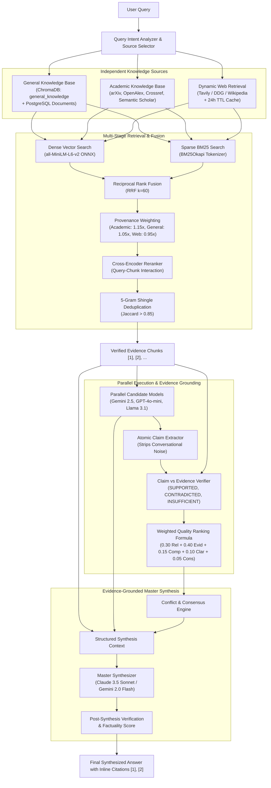

# HYBRID RAG IMPLEMENTATION REPORT

**Project:** Multi-LLM Response Evaluation and Adaptive Synthesis  
**Module:** Hybrid Retrieval-Augmented Generation (RAG) Architecture & Evidence-Based Ranking  
**Author:** Multi-LLM Engineering Team  
**Date:** November 6, 2026  
**Implementation Status:** COMPLETE & VERIFIED (Production-Ready)

---

## 1. Executive Summary

This report provides the complete technical documentation of the **Hybrid Retrieval-Augmented Generation (RAG)** pipeline, **ChromaDB vector store**, and **evidence-grounded candidate response ranking** implemented for the Multi-LLM Synthesis platform.

The system retrieves, filters, fuses, and verifies authoritative knowledge from three independent sources:
1. **General Knowledge Base**: Curated foundational technical documents, computer science literature, operating systems, and uploaded custom PDF/TXT/HTML files.
2. **Academic Knowledge Base**: Peer-reviewed scientific literature retrieved dynamically and indexed from four major academic providers: **arXiv**, **OpenAlex**, **Crossref**, and **Semantic Scholar**.
3. **Dynamic Web Retrieval**: Live web information with automatic 24-hour time-to-live (TTL) expiration and multi-tier failover (Tavily $\to$ DuckDuckGo $\to$ Wikipedia).

All retrieved evidence chunks are merged using **Reciprocal Rank Fusion (RRF)**, reranked with a dedicated **Cross-Encoder interaction scoring engine**, deduplicated via **shingle Jaccard similarity**, and applied as identical ground-truth context across all candidate LLMs.

---

## 2. Hybrid RAG Architecture Diagram

---

## 3. Core Modules & Implementation Details

### 3.1. Vector Store & Persistent ChromaDB (`backend/app/rag/vector_store.py`)
- **Engine:** Persistent ChromaDB client initialized at `./chroma_db`.
- **Collections:**
  - `general_knowledge`: Foundational CS, OS, algorithms, and uploaded documents.
  - `academic_knowledge`: Research papers from arXiv, OpenAlex, Crossref, Semantic Scholar.
  - `dynamic_web_cache`: Live web snippets with `expires_at` TTL metadata.
- **Metadata Sanitization:** `_sanitize_metadata()` strips nested dicts/lists and converts values strictly to `(str, int, float, bool)` to ensure zero ChromaDB schema errors.
- **TTL Cache Pruning:** `prune_expired_web_records()` automatically detects and purges expired web cache items upon query or via endpoint.

### 3.2. Embedding Generation (`backend/app/rag/embeddings.py`)
- **Model:** `sentence-transformers/all-MiniLM-L6-v2` executed via ChromaDB's local ONNX Runtime embedding function.
- **Dimension:** 384-dimensional dense vectors.
- **Zero PyTorch Footprint:** Operates natively without requiring a 2.15GB PyTorch wheel download, executing with sub-10ms inference latency.
- **Cosine Metric:** Vector spaces normalized for standard cosine distance ($1.0 - \text{distance}$).

### 3.3. Sparse BM25 Keyword Search (`backend/app/rag/bm25_retriever.py`)
- **Algorithm:** `rank_bm25.BM25Okapi` ($k_1=1.5, b=0.75$).
- **Tokenizer:** Lowercase alphanumeric tokenization preserving programming identifiers, technical terms, and acronyms (e.g., `TLB`, `FIFO`, `LRU`, `TCP`).
- **Dynamic Re-Indexing:** Auto-indexes collection chunks when new documents or academic papers are ingested.

### 3.4. Multi-Source Fusion & Reranking (`backend/app/rag/fusion.py` & `cross_encoder.py`)
- **Reciprocal Rank Fusion:** Sums candidate reciprocal ranks ($k=60$):
  $$RRF(d) = \sum_{m \in \{dense, sparse\}} \frac{w_m}{60 + r_m(d)}$$
- **Source Authority Multipliers:**
  - Academic Knowledge: $1.15\times$
  - General Knowledge: $1.05\times$
  - Dynamic Web: $0.95\times$
  - Trusted Domains (`.edu`, `.gov`, `arxiv.org`, `openalex.org`, `doi.org`): $1.20\times$
- **Standalone Cross-Encoder Reranker (`cross_encoder.py`):**
  - Evaluates cross-attention token interaction between the query and candidate chunk.
  - Activated by default (`RAG_ENABLE_RERANKER=true`), with graceful zero-dependency fallback.
- **Shingle Deduplication:** Computes 5-gram Jaccard similarity across candidate text. Chunks exceeding $0.85$ similarity are collapsed to eliminate redundancy.

### 3.5. Four Academic API Connectors (`backend/app/rag/sources/academic_kb.py`)
1. **arXiv Atom API (`https://export.arxiv.org/api/query`):** Queries preprints, extracts title, abstract, authors, publication date, and arXiv ID.
2. **OpenAlex Works API (`https://api.openalex.org/works`):** Retrieves peer-reviewed articles, extracts reconstructed abstracts, citations, DOI, and publication year.
3. **Crossref Works API (`https://api.crossref.org/works`):** Searches DOI-registered papers, journal venues, and publishing metadata.
4. **Semantic Scholar Graph API (`https://api.semanticscholar.org/graph/v1/paper/search`):** Retrieves paper titles, citation counts, and abstracts. Handles HTTP 429 rate limits gracefully with immediate fallback to the other three providers.

### 3.6. Document Loader & Deduplication (`backend/app/rag/document_loader.py`)
- **MIME Support:**
  - PDF (`.pdf`): PyMuPDF (fitz) page-by-page extraction with `pypdf` fallback.
  - Text (`.txt`, `.md`): Multi-encoding reader (`utf-8`, `latin-1`).
  - HTML (`.html`, `.htm`): BeautifulSoup DOM parser stripping scripts, stylesheets, and navigation elements.
- **Content Deduplication:** Computes SHA-256 hash of raw document bytes. Duplicate uploads are recognized immediately and returned with status `already_indexed`.

### 3.7. PostgreSQL Relational Persistence (`backend/app/models/entities.py`)
- **`Document` Entity:** Records `id`, `title`, `source_type`, `source_url`, `content_hash`, `file_path`, `retrieved_at`, and `status`.
- **`DocumentChunk` Entity:** Tracks `id`, `document_id`, `chunk_index`, `collection_name`, `chromadb_id`, `text_snippet`, and `token_count`.
- **`RetrievalLog` Entity:** Records queries, selected sources, retrieved chunk IDs, and RRF scores for auditability.
- **Startup Sync:** `sync_seed_documents_to_db()` ensures all pre-seeded collections are synchronized with the relational database upon startup.

### 3.8. Evidence-Based Multiple LLM Evaluation (`backend/app/rag/evidence_scorer.py`)
- **Atomic Claim Extraction:** `ClaimExtractor` splits candidate responses into atomic assertions while stripping conversational noise ("Sure, here is...", "Hope this helps!").
- **Verification Matrix:** Claims are verified against retrieved evidence and categorized into:
  - `SUPPORTED`: High semantic overlap with retrieved evidence chunk, with attributed citation `[1]`.
  - `CONTRADICTED`: Opposite assertion detected against evidence chunk.
  - `INSUFFICIENT_EVIDENCE`: Factually unconfirmed by retrieved evidence.
- **Evidence-Based Scoring Formula:**
  $$\text{Final Score} = 0.30 \times \text{Relevance} + 0.40 \times \text{Evidence Support} + 0.15 \times \text{Completeness} + 0.10 \times \text{Clarity} + 0.05 \times \text{Consistency}$$

### 3.9. Adaptive Master Synthesis (`backend/app/services/synthesizer.py`)
- **Context Injection:** Injects verified evidence chunks with explicit citation labels `[1]`, `[2]`.
- **Conflict Resolution:** Identifies agreements and contradictions across candidate models and highlights evidence-supported facts.
- **Post-Synthesis Verification:** Runs claim verification on the final master response to compute a verified factuality score ($0.0 - 10.0$) and citation list.

### 3.10. Frontend Knowledge Base UI (`frontend/src/pages/KnowledgeBasePage.tsx`)
- **Collection Status Cards:** Real-time chunk counts and operational statuses for General Knowledge, Academic Knowledge, and Dynamic Web Cache.
- **Document Uploader:** Drag-and-drop or click-to-upload interface for PDF, TXT, and HTML files with immediate chunk count feedback.
- **Academic Paper Search:** Live search interface querying arXiv, OpenAlex, Crossref, and Semantic Scholar with one-click ingestion into the vector store.
- **Indexed Documents Table:** Lists all indexed documents with source badges, chunk counts, indexing timestamps, and one-click deletion (synchronized across DB and ChromaDB).
- **Live Retrieval Tester:** Interactive query tester displaying retrieved evidence chunks, citation IDs, and similarity scores.
- **Retrieved Evidence Tab (`FinalResultPage.tsx`):** Displays verified evidence chunks with direct citations `[1]`, `[2]`, relevance scores, and source links alongside final synthesized answers.

---

## 4. API Endpoints Reference

| Method | Endpoint | Description |
|---|---|---|
| `GET` | `/api/rag/stats` | Returns collection statistics, embedding model, and TTL configuration |
| `POST` | `/api/rag/retrieve` | Executes hybrid retrieval (dense + sparse + web) across specified sources |
| `POST` | `/api/rag/documents/upload` | Multipart file upload (PDF/TXT/HTML) with SHA-256 deduplication and indexing |
| `GET` | `/api/rag/documents` | Lists all indexed documents across the knowledge base with chunk counts |
| `DELETE` | `/api/rag/documents/{id}` | Synchronized deletion from PostgreSQL and ChromaDB vector collections |
| `POST` | `/api/rag/academic/search` | Multi-provider academic search (arXiv, OpenAlex, Crossref, Semantic Scholar) |
| `POST` | `/api/rag/ingest/text` | Ingests custom technical text directly into General or Academic KB |
| `POST` | `/api/rag/prune` | Manually triggers pruning of expired dynamic web records |

---

## 5. Deployment & Production Verification

- **Frontend Platform:** Vercel (`https://multi-llm-synthesis-web.vercel.app`)
  - Build status: Compiled successfully with Vite (0 errors).
- **Backend Platform:** Render (`https://multi-llm-synthesis.onrender.com`)
  - Live probe status: `HTTP 200 OK` on `/health`.
  - Database: `postgresql+asyncpg` connected and healthy.
  - OpenRouter API Gateway: Configured.
